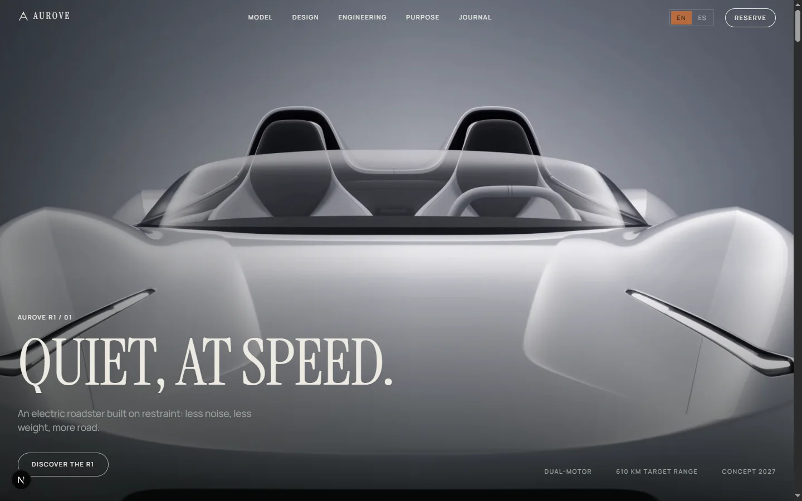

# Aurove Motors

Single-page site for a fictional electric roadster, the Aurove R1. Dark, typographic and motion-led: a full-bleed hero film, scroll-scrubbed cinematic interludes and a restrained copper-on-ink palette.



Live: <https://aurove-motors.vercel.app>

## What it is

A marketing site with twelve sections: hero, vision, driver engineering, film interlude, manifesto, systems, material interlude, purpose, journal, reservation, footer and a mobile menu. Navigation is anchor-based, there are no secondary routes, and everything ships as static pages per locale.

The product, company, people and figures are invented. Nothing on the site describes a real vehicle or takes payment.

## Stack

| Layer | Choice |
| --- | --- |
| Framework | Next.js 16.4.3 (App Router) |
| UI | React 19, TypeScript 5.7 |
| Motion | GSAP 3 with ScrollTrigger, Lenis smooth scroll |
| Styling | Plain CSS with custom properties in `src/app/globals.css` |
| Fonts | Instrument Serif and Manrope via `next/font` (self-hosted at build) |
| Analytics | `@vercel/analytics` |

No CSS framework and no component library: the design system is a set of tokens plus utility classes.

## Getting started

Requirements: Node.js 20.9 or newer and pnpm.

```bash
pnpm install
pnpm dev
```

The dev server runs at <http://localhost:3000> and redirects to `/en` or `/es` based on the `Accept-Language` header.

## Scripts

| Command | Purpose |
| --- | --- |
| `pnpm dev` | Development server |
| `pnpm build` | Production build (typechecked; no ignored build errors) |
| `pnpm start` | Serve the production build |
| `pnpm lint` | ESLint with `eslint-config-next` |
| `pnpm typecheck` | `tsc --noEmit` |

## Project structure

```text
src/
  app/
    [locale]/           # en/es layout, page, OG image, 404
    globals.css         # tokens, utilities, component styles
    robots.ts, sitemap.ts
  components/           # sections, header, mobile menu, cursor
  config/site.ts        # site URL, name, locale defaults
  hooks/                # reduced motion, touch detection
  i18n/
    config.ts           # locales, default locale, cookie
    dictionaries/       # typed en/es dictionaries
    get-dictionary.ts
  lib/                  # SEO helpers, date formatting
  proxy.ts              # locale detection and redirect
```

Locale is a route segment. `proxy.ts` sends `/` and unknown paths to `/en` unless the `aurove.locale` cookie or the `Accept-Language` header selects Spanish.

## Internationalization

Every visible string lives in `src/i18n/dictionaries/en.ts` or `es.ts`. The English file exports the `Dictionary` type; Spanish must satisfy the same shape, so a missing translation fails the typecheck.

`generateStaticParams` pre-renders both locales. Metadata, canonical URLs and `hreflang` alternates are generated per locale, and the OG image is rendered at request time with `next/og`.

## Design system

| Token | Value | Use |
| --- | --- | --- |
| `--ink` | `#0B0E0D` | Dark sections, text on light |
| `--ink-deep` | `#070A09` | Interludes and footer |
| `--bone` | `#EDEAE2` | Light sections, text on dark |
| `--surface` | `#F7F5F0` | Elevated light surface |
| `--copper` | `#B86B3F` | Accent, active locale |

Display type is Instrument Serif at weight 400; body and labels are Manrope. The scale (`--display-xl` through `--micro`) is fluid, using `clamp()`.

Motion respects `prefers-reduced-motion`: when set, GSAP timelines, the custom cursor and Lenis are disabled and content renders in its final state.

## Media

All media is local and static under `public/`:

- 13 WebP images in `public/assets/`, including the hero poster.
- `public/video/r1-film.mp4` (14.9 MB), reused for the hero and the cinematic interlude.
- `public/brand/aurove-mark.svg` and `src/app/icon.svg` for identity and favicon.

The imagery is placeholder studio imagery supplied with the original scaffold. It is not licensed photography; replace it before using the site commercially. See the provenance note for details.

Videos are served unoptimized; the film is the largest asset and the main performance cost. Consider compressing it or serving a shorter loop before a real launch.

## Deployment

The site is built for Vercel with the Git integration: every push to `main` deploys to production. No environment variables are required. To set the canonical origin explicitly, define `NEXT_PUBLIC_SITE_URL` (for example `https://aurove-motors.vercel.app`) in Production and Preview.

Any Node host works with `pnpm build && pnpm start`. The site has no server-side data dependencies.

## License and provenance

Code and brand are proprietary, all rights reserved. See [LICENSE](LICENSE) and [NOTICE](NOTICE). The brand, name and copy are original to this project.

The layout and motion vocabulary derive from a v0-generated scaffold; the identity, palette, typography, copy, routing, SEO and structure were replaced. Asset provenance and residual risks are documented in [docs/provenance.md](docs/provenance.md).
